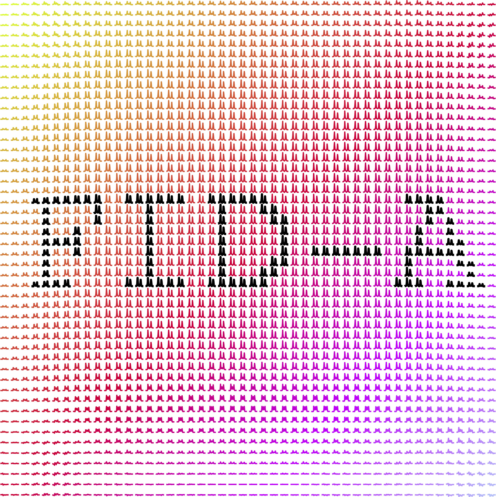

# FID-A



Toolbox for simulation and processing of in-vivo magnetic resonance
spectroscopy (MRS) data.

This repository is a fork of [CIC-methods/FID-A](https://github.com/CIC-methods/FID-A),
extended with MRSI reconstruction, processing and visualization tools.

## Getting started

Requires MATLAB and, for the steps below, a working internet connection.

### 1. Get the code

**Option A — download a ZIP**

Go to <https://github.com/K-Divyasri/fida>, click **Code → Download ZIP**,
unzip `fida-main.zip`, and move the resulting `fida-main` folder wherever you
keep your MATLAB code (e.g. `/Users/JohnDoe/MatlabStuff/`).

**Option B — clone with git (recommended)**

```bash
cd /Users/JohnDoe/MatlabStuff
git clone https://github.com/K-Divyasri/fida.git
```

Option B lets you pull later updates with `git pull`, and it is the only way to
get the example MRS data (see [Example data](#example-data)).

### 2. Add FID-A to your MATLAB path

```matlab
% Option A (downloaded ZIP)
addpath(genpath('/Users/JohnDoe/MatlabStuff/fida-main'));

% Option B (git clone)
addpath(genpath('/Users/JohnDoe/MatlabStuff/fida'));
```

### 3. Start using the toolbox

Example scripts live in `exampleRunScripts/`; the manual is at
`FID-A_Documentation/FID-A_Manual.pdf`.

## Example data

> **Important**
> FID-A ships a folder of example MRS data that is useful for testing, but it
> is stored with git Large File Storage (LFS) and is **only** available through
> Option B. A ZIP download does not include it.
>
> For Option B to fetch it, you need both `git` and the
> [git-lfs](https://git-lfs.github.com) extension installed. Follow the
> git-lfs installation instructions; once it is installed, `git clone` pulls
> the example data along with the rest of the repository.

## Repository layout

| Folder | Contents |
| --- | --- |
| `inputOutput/` | readers and writers for vendor and NIfTI-MRS formats |
| `processingTools/` | single-voxel and MRSI processing (`processingTools/MRSI/`) |
| `simulationTools/` | density-matrix and shaped-pulse simulations |
| `rfPulseTools/` | RF pulse design and analysis |
| `exampleRunScripts/` | end-to-end example pipelines |
| `viz/` | MRSI map, overlay and spectra-on-T1 visualization |
| `test/`, `tests/` | test and comparison scripts |
| `libraries/` | bundled third-party code (e.g. `dicm2nii`) |
| `FID-A_Documentation/` | manual and logo |

## License

FID-A is released under the BSD license see [LICENSE.txt](LICENSE.txt).
Copyright 2020 Jamie Near.
